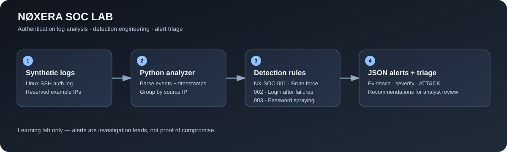

# NØXERA SOC Lab

A beginner-friendly defensive security portfolio project that demonstrates authentication log parsing, detection engineering, alert triage, and incident documentation using Python and synthetic Linux SSH logs.

> **Safe lab:** The included logs use documentation-only IP addresses and synthetic events. This tool analyzes a local file; it does not scan networks, access accounts, block traffic, or perform offensive actions.



## Features

- Parse Linux-style SSH authentication successes and failures.
- Generate structured JSON alerts with evidence and analyst triage steps.
- Apply three detection rules to a configurable rolling time window.
- Run repeatable unit tests with Python's standard library only.
- Keep sample data and detection logic documented for portfolio review.

## Detection rules

| Rule | Detection | Default severity | MITRE ATT&CK |
|---|---|---|---|
| NX-SOC-001 | Repeated SSH authentication failures from one IP in a rolling window | Medium | T1110 — Brute Force |
| NX-SOC-002 | Successful SSH login after repeated failures from the same IP | High | T1110 — Brute Force; T1078 — Valid Accounts (investigate, not confirmed) |
| NX-SOC-003 | Failed SSH attempts targeting multiple distinct accounts from one IP | Medium | T1110.003 — Password Spraying |

These rules produce investigation leads, not proof that an account or system is compromised.

## Requirements

- Python 3.10 or newer
- No third-party dependencies

## Run the analyzer

From the repository root:

```bash
python src/analyze_auth_logs.py --input data/auth.log --output reports/alerts.json --threshold 5 --window-minutes 10
```

On Windows, if `python` is not on PATH, use your installed Python executable or the Python launcher available on your machine.

The command prints the number of parsed events and alerts, then writes the JSON report to `reports/alerts.json`.

## Run tests

```bash
python -m unittest discover -s tests -v
```

The tests cover positive and negative cases for the detection rules, including events outside the rolling window and repeated failures against only one account.

## Example analyst workflow

1. **Validate:** Confirm the time range, source IP, and event counts in the original logs.
2. **Scope:** Identify targeted accounts and any affected hosts.
3. **Correlate:** Look for successful logins after failures and related events across other log sources.
4. **Assess:** Consider account privilege, business context, and whether activity is expected.
5. **Respond:** Follow approved incident-response procedures; avoid containment actions based on a single heuristic alone.
6. **Document:** Record evidence, confidence, impact, and next steps using `reports/incident-report-template.md`.

## Project structure

```text
noxera-soc-lab/
├── data/                 # Synthetic authentication log
├── detections/           # Detection-rule documentation
├── reports/              # Example JSON alerts and incident template
├── src/                  # Python analyzer
├── tests/                # Unit tests
├── docs/                 # Demo walkthrough
└── README.md
```

## Limitations

- This is a learning project, not a production SIEM or an endpoint protection product.
- It analyzes the supplied file only; it does not continuously monitor a host or ingest a live log stream.
- Traditional syslog timestamps omit the year; the current implementation assigns the current UTC year. Historical logs around year boundaries require better timestamp handling.
- Detection thresholds must be tuned for the environment, and alerts require human validation.

## Git identity setup

When contributing from your own computer, configure Git with your own identity (replace the examples):

```powershell
git config --global user.name "Your Name"
git config --global user.email "your-email@example.com"
```

These values label your commits; they do not authenticate you to GitHub. Your name and email may appear in commit history, so consider using your Git hosting provider's private `noreply` email address.

## Skills demonstrated

Python scripting · Authentication log analysis · Detection engineering · JSON reporting · Unit testing · Alert triage · Incident documentation · MITRE ATT&CK mapping · Git/GitHub

## Roadmap

- [x] Synthetic SSH authentication dataset
- [x] Three documented detection rules
- [x] JSON alert reporting
- [x] Unit tests for detection behavior
- [ ] Add Windows Event Log parsing
- [ ] Add more synthetic scenarios and regression tests
- [ ] Add a small local dashboard
- [ ] Improve timestamp handling for historical logs and year boundaries

## Run the SOC Dashboard

### Install dependencies

``powershell
& "$env:LocalAppData\Programs\Python\Python314\python.exe" -m pip install -r requirements.txt
``

### Generate alerts

``powershell
& "$env:LocalAppData\Programs\Python\Python314\python.exe" src\analyze_auth_logs.py --input data\auth.log --output reports\alerts.json --threshold 5 --window-minutes 10
``

### Launch the dashboard

``powershell
& "$env:LocalAppData\Programs\Python\Python314\python.exe" -m streamlit run app.py
``

Open http://localhost:8501 in your browser. Press Ctrl+C in the terminal to stop the dashboard.

This project uses synthetic authentication logs for defensive security learning. Alerts are investigation leads, not proof of compromise.
